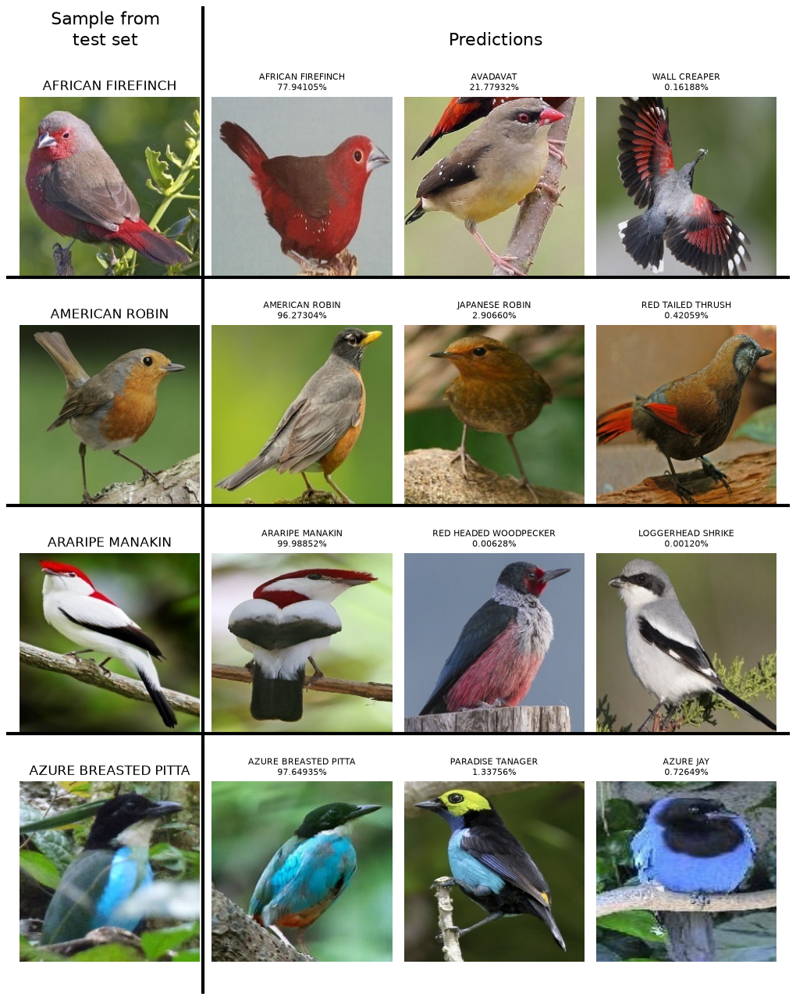
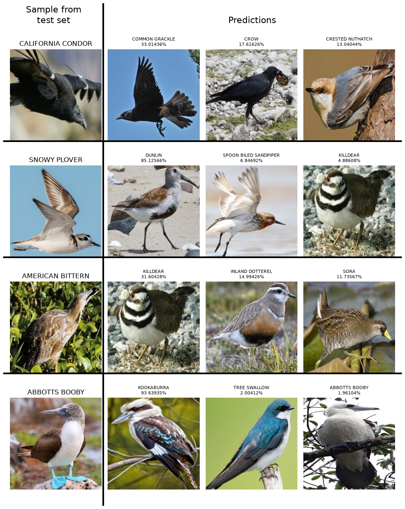

<h1>Vision transformer for Bird Classification</h1>

Code from a bird classifier project from 2024. The data is from the Kaggle public dataset in: https://www.kaggle.com/datasets/rahmasleam/bird-speciees-dataset

Architecture is a simple vision transformer with the following hyper parameters:
hidden_dim: 512
num_heads: 8
num_layers: 8
embedding_dim: 128

1.7M trainable parameters

Achieves ~81% accuracy on the validation dataset.

Examples of bird classes with 100% accuracy:

Examples of bad birds with 33% or so accuracies:

